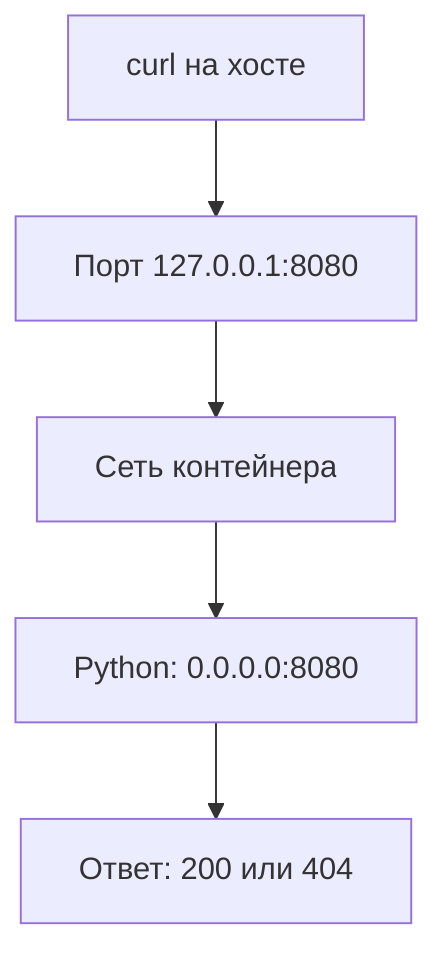
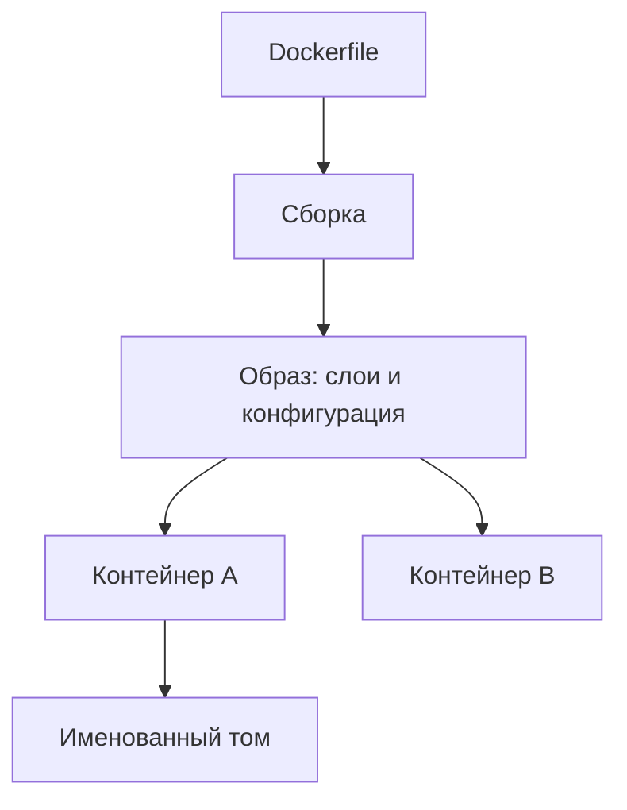
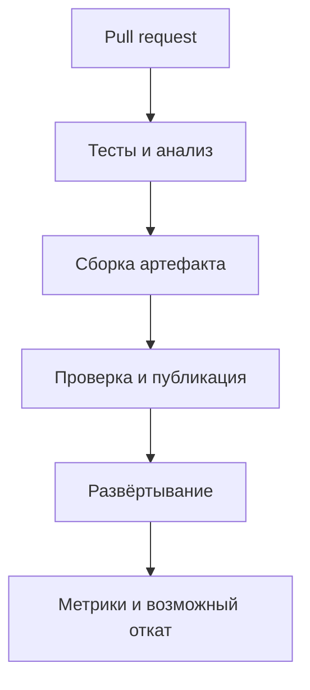
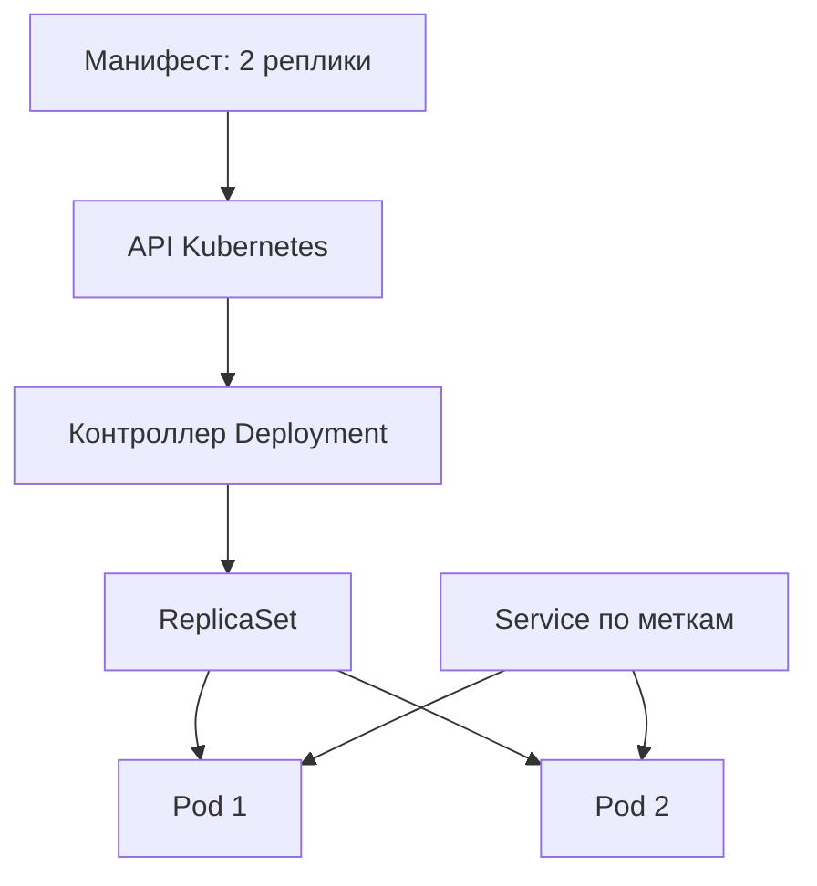
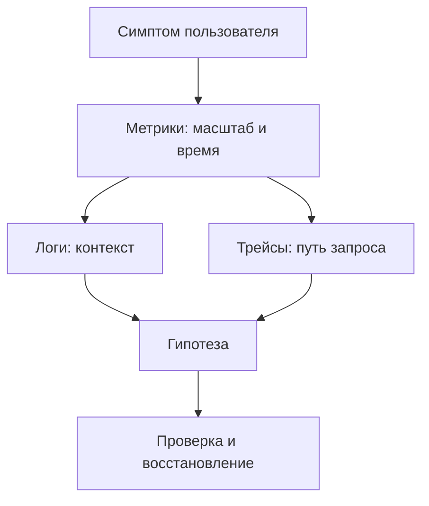
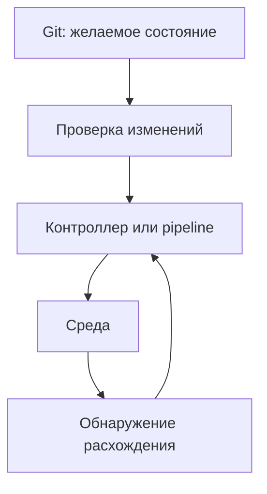

# DevOps изнутри: схемы и продвинутая теория

Дополнение к [практикуму](README.md). Читайте разделы вместе с соответствующими работами и выполняйте эксперименты в учебном окружении. Схемы упрощают устройство систем; поведение зависит от конфигурации.

## 1. Как запрос попадает в приложение

Порт - номер конечной точки транспортного протокола. Процесс слушает адрес и порт через сокет. При прослушивании 0.0.0.0 означает все доступные IPv4-интерфейсы в сетевом пространстве процесса; это не адрес назначения для клиента. 127.0.0.1 означает loopback текущего сетевого пространства. Поэтому localhost контейнера - сам контейнер, а не хост или соседний сервис.

Публикация `127.0.0.1:8080:8080` сопоставляет порт хоста с портом контейнера и не меняет порт приложения. В Compose сервисы общаются по DNS-имени сервиса и внутреннему порту.

| Симптом | Значение | Что проверить |
|---|---|---|
| Connection refused | Соединение отклонено | Слушатель, адрес, порт и публикацию |
| Timeout | Ответ не получен вовремя | Маршрут, фильтрацию, нагрузку, таймаут |
| HTTP 404 | Сервер ответил, путь не найден | URL и маршрутизацию |
| HTTP 503 | Компонент сообщил о недоступности | Кто именно ответил и почему |

**Эксперимент после работы 3:** запустите контейнер без публикации порта и проверьте curl с хоста. Добавьте публикацию с внешним портом 8081 и выполните `curl http://127.0.0.1:8081/healthz`. Объясните разницу между внешним и внутренним портом.

### Таймауты и повторные запросы

Timeout не доказывает, что сервер не выполнил запрос: ответ мог потеряться после записи. Повтор GET обычно безопаснее повтора создания платежа. Для операций с побочным эффектом применяют ключ идемпотентности, который сервер связывает с результатом. Ограничение числа повторов, экспоненциальная задержка и случайный разброс помогают не усилить аварию. Ключ работает только если сервер реализует его надлежащим образом.

**Вопрос:** клиент получил timeout после POST. Создана ли запись? По одному таймауту неизвестно: проверьте состояние или повторите с тем же ключом, если API его поддерживает.

## 2. Образы, контейнеры и данные

Образ - шаблон; контейнер - экземпляр с собственным записываемым слоем. При удалении контейнера его слой удаляется, а именованный том обычно остаётся. В работе 4 Redis сохраняет данные в томе; приложение пока к Redis не подключено. Том не является резервной копией: ошибка пользователя или повреждение могут уничтожить единственный экземпляр.

Контейнеры используют механизмы ядра хоста, включая namespaces и cgroups. В отличие от полноценной VM, контейнеры в одной Linux-среде разделяют ядро. На Docker Desktop они обычно работают внутри Linux VM. Запуск без root уменьшает часть рисков, но не делает контейнер полной границей безопасности.

**Эксперимент:** сохраните ключ по инструкции работы 4, выполните `docker compose down`, поднимите проект и проверьте ключ. Затем только в учебном проекте выполните `docker compose down -v`, снова запустите и проверьте отсутствие ключа. Почему результаты различаются?

### Цепочка поставки

Тег образа может быть переназначен; digest идентифицирует конкретное содержимое. Фиксация digest повышает повторяемость, но требует намеренных обновлений безопасности. Исключайте лишнее через .dockerignore и не копируйте секреты в слои. Сканер выявляет известные уязвимости, но не доказывает отсутствие дефектов. SBOM описывает компоненты; подписи и provenance помогают проверить происхождение артефакта.

## 3. CI/CD и доверие

В работе 5 реализованы тесты и сборка; публикация и deployment на схеме показывают возможное развитие. Зелёный CI означает, что заданные проверки прошли на конкретном коммите в конкретной среде, а не отсутствие всех ошибок.

**Build once, deploy many:** продвигайте один и тот же неизменяемый артефакт между окружениями. Повторная сборка способна получить изменившуюся зависимость, и проверенный артефакт будет отличаться от развёрнутого. Проверяйте также миграции, конфигурацию и поведение после выпуска.

Код внешнего PR может быть недоверенным. Ограничивайте permissions workflow, не передавайте ему секреты, закрепляйте сторонние actions полным SHA. OIDC позволяет получать короткоживущие облачные полномочия вместо постоянного ключа, но политика доверия должна ограничивать допустимый репозиторий, ветку и окружение.

**Эксперимент:** в своей ветке измените ожидаемый статус в тесте и убедитесь, что CI упал именно на тесте. Исправьте и сравните SHA двух запусков.

## 4. Kubernetes и согласование состояния

Deployment описывает желаемое состояние. Контроллеры сравнивают его с наблюдаемым и пытаются устранить расхождение. Планировщик назначает Pod узлу, kubelet запускает контейнеры. Если Pod удалён, контроллер создаёт замену, но восстановление не мгновенно: может не хватить ресурсов или не скачаться образ.

Service выбирает Pod по меткам. Readiness влияет на доступность endpoint для обычного трафика; сам Service не запускает приложение. В лабораторной доступ организован через port-forward: публичный ingress и TLS не настроены.

| Проверка | Вопрос | При повторном неуспехе |
|---|---|---|
| Startup | Закончен ли запуск? | Контейнер перезапускается; остальные пробы ждут успеха startup |
| Readiness | Готов ли Pod обслуживать запросы? | Pod не готов к обычному трафику Service, перезапуск не обязателен |
| Liveness | Нужно ли перезапустить зависший контейнер? | Kubelet перезапускает контейнер |

В учебном манифесте есть только readiness. Агрессивная liveness, зависящая от внешней базы, способна вызвать массовые рестарты при её сбое. Разделяйте проверку живости процесса и готовность выполнять запросы.

**Эксперимент после работы 6:** проверьте, что контекст относится к учебному кластеру. Получите имя Pod через `kubectl -n devops-lab get pods`, удалите один учебный Pod и наблюдайте `kubectl -n devops-lab get pods -w`. Остановите просмотр Ctrl+C, сравните имена и проверьте ответ через Service.

### Обновление, откат и ресурсы

RollingUpdate создаёт новые Pod и убирает старые по стратегии maxSurge/maxUnavailable. При плохом образе продвижение может остановиться, а старые готовые Pod продолжат отвечать, в зависимости от стратегии и состояния. `rollout undo` возвращает предыдущий шаблон Deployment, но не откатывает данные и миграции БД. Совместимые миграции удобно проводить по этапам: добавить структуру, перевести чтение и запись, затем удалить старую после проверки.

Scheduler учитывает requests при размещении. CPU limit может вызвать throttling; нехватка памяти может завершиться OOM kill. Завышенный request способен оставить Pod в Pending; заниженный приводит к плотному размещению. Значения выбирают по измерениям и пикам. HPA не исправит общий узкий ресурс, например перегруженную базу.

**Диагностика:** используйте `kubectl -n devops-lab rollout status deployment/app`, `kubectl -n devops-lab describe pod ИМЯ` и при наличии предыдущего контейнера `kubectl -n devops-lab logs ИМЯ --previous`. События и логи помогают строить гипотезы; одно наблюдение не всегда доказывает причину.

## 5. Метрики, логи и инциденты

Метрики показывают агрегаты во времени, логи - события, трейсы - связи между участками запроса. Совпадение событий по времени помогает строить гипотезу, но не доказывает причинность. В учебном приложении пока нет готового экспортера и распределённой трассировки.

Для HTTP начните с RED: частоты запросов, доли ошибок и длительности. Для ресурсов полезны utilization, saturation и errors. Среднее скрывает хвост: p99 означает, что 99% наблюдений в выбранном наборе не превышают соответствующее значение. Усреднение p99 разных серверов не даёт общий p99; используйте агрегируемые гистограммы с совместимыми границами.

**SLI и SLO:** пусть SLI - доля успешных запросов за 30 дней, а SLO - 99,9%. При миллионе запросов бюджет ошибок соответствует примерно тысяче неуспешных запросов. При малом количестве запросов интерпретация меняется. Алерт должен отражать значимое влияние, иметь ответственного и ссылку на runbook.

**Разбор:** /healthz возвращает 200, но пользователи получают ошибки функции с базой. Назовите две гипотезы и наблюдение, способное опровергнуть каждую. Учебный health endpoint проверяет только процесс и не доказывает доступность Redis.

## 6. IaC, GitOps и восстановление

IaC описывает ресурсы декларативно. Инструмент сопоставляет конфигурацию с известным состоянием и формирует план. State связывает описания с объектами, может содержать чувствительные данные и требует защиты, блокировки и резервирования. Проверяйте план перед применением и результат после него. Облачные ресурсы могут стоить денег.

GitOps использует версионированное желаемое состояние и контроллер, который сверяет его со средой. Ручную правку контроллер может перезаписать. Git не является безопасным хранилищем секретов; base64 в Kubernetes Secret не равен шифрованию. Используйте подходящее хранилище, ограниченный доступ и ротацию. Здесь пока нет готовой лабораторной IaC или развёрнутого GitOps-контроллера.

RPO - допустимая потеря данных во времени; RTO - целевое время восстановления. Наличие копии не подтверждает достижение этих целей: восстановите её в отдельной среде, проверьте целостность, права и работу приложения, измерьте время. Том Compose сам по себе не резервная копия.

**Упражнение:** опишите, кто меняет production-манифест, как проверяется PR и что произойдёт при дрейфе. Отдельно опишите откат приложения и восстановление данных. Для учебного Redis предложите согласованную копию, восстановление в отдельный экземпляр и проверку известного ключа.

## Проверьте себя

1. Почему HTTP 404 и connection refused требуют разных действий?
2. Почему повтор POST после timeout может создать дубликат?
3. Чем digest отличается от тега и почему его нужно обновлять?
4. Почему зелёный CI не гарантирует совместимость миграции?
5. Чем последствия провала readiness отличаются от liveness?
6. Почему откат Deployment не гарантирует откат состояния базы?
7. Почему среднее и p99 отвечают на разные вопросы?
8. Чем том отличается от проверенной резервной копии?

## Документация

- [Docker: сеть](https://docs.docker.com/engine/network/) и [тома](https://docs.docker.com/engine/storage/volumes/)
- [Kubernetes: пробы](https://kubernetes.io/docs/concepts/configuration/liveness-readiness-startup-probes/), [Deployment](https://kubernetes.io/docs/concepts/workloads/controllers/deployment/) и [ресурсы](https://kubernetes.io/docs/concepts/configuration/manage-resources-containers/)
- [Безопасность GitHub Actions](https://docs.github.com/en/actions/security-for-github-actions/security-guides/security-hardening-for-github-actions)
- [Google SRE: SLO](https://sre.google/sre-book/service-level-objectives/)
- [Prometheus: гистограммы](https://prometheus.io/docs/practices/histograms/)
